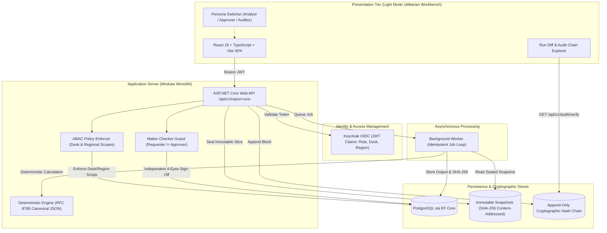

# Risk and Regulatory Reporting Workbench

> **DISCLAIMER & LIMITATIONS**  
> **This is a simulated system built strictly with synthetic exposure and trade datasets.**  
> It is **NOT** a regulatory, banking, or production system, and must **NOT** be used for actual regulatory submissions, statutory compliance reporting, or real financial transactions. Do not use any real bank data.

---

## 1. System Architecture

The Risk and Regulatory Reporting Workbench executes versioned report templates against synthetic exposure slices, creates immutable content-addressed input snapshots, computes risk metrics in a background worker, and routes runs through maker-checker 4-eyes approval with a tamper-evident cryptographic hash chain.



---

## 2. Technology Stack & Architectural Components

The workbench is architected as a modular monolith paired with an asynchronous background calculation worker, designed for financial institutions requiring strict determinism, tamper-evident audit trails, and multi-tenant desk/region isolation.

| Tier / Domain | Technology | Purpose & Responsibility |
| :--- | :--- | :--- |
| **Backend API** | **C# / .NET 8 ASP.NET Core Web API** | REST API endpoints (`/api/v1/report-runs`, `/api/v1/audit/verify`), request routing, RFC 7807 Problem Details error formatting. |
| **Data Persistence** | **PostgreSQL 16 & Entity Framework Core 8** | Relational data persistence, optimistic concurrency control (`xmin` row tokens), connection pooling via Npgsql. |
| **Async Worker** | **ASP.NET Core `BackgroundService` (`IHostedService`)** | Dedicated background execution loop for report calculations, idempotent retries, snapshot loading, and failure containment. |
| **Identity & Access** | **Keycloak 23 (OIDC / OAuth 2.0)** | Role-Based (RBAC) and Attribute-Based Access Control (ABAC). Issues signed RS256 JWT tokens with `role`, `desk`, and `region` claims. |
| **Frontend SPA** | **React 18 / 19, TypeScript, Vite** | Utilitarian enterprise workbench in light mode, high-density tabular data grids, zero-pill typographic discipline, and client-side diff inspector. |
| **Styling & UI** | **Tailwind CSS v4 & Lucide React** | Anti-AI-slop design system adhering to 60-30-10 color allocation, strict tabular figures (`font-mono tabular-nums`), and WCAG AA contrast. |
| **Determinism & Cryptography** | **RFC 8785 Canonical JSON (JCS) & SHA-256** | Guarantees byte-identical outputs across runs and seals immutable snapshots and audit chain blocks. |
| **Observability** | **OpenTelemetry .NET SDK & OTel Collector** | Distributed tracing and metrics for HTTP requests, EF Core query execution, and worker task latencies. |
| **Testing** | **xUnit, Testcontainers, React Testing Library, Playwright** | Reproducibility verification tests, 24-combination Permission Matrix tests, and end-to-end user workflows. |
| **DevOps & Containers** | **Docker, Docker Compose, GitHub Actions** | Multi-container orchestration (`api`, `postgres`, `keycloak`, `otel-collector`), automated CI pipeline, and Trivy security scanning. |

---

## 3. Core Functional Invariants

1. **Immutable Input Snapshots**: When a run is queued "as of" date $T$, the matching exposures are sorted by `tradeId`, serialized to canonical RFC 8785 JSON, and sealed with a SHA-256 hash. The worker never reads live tables.
2. **Byte-Identical Reproducibility**: Executing the identical template version against the identical sealed snapshot produces identical canonical bytes and an identical SHA-256 hash.
3. **Maker-Checker Separation of Duties**: The user who triggered the run is mathematically and authorizationally barred from approving it. Approved runs become permanently immutable.
4. **Tamper-Evident Hash Chain**: Each audit row seals the preceding row's block hash ($\text{previousHash}_i = \text{blockHash}_{i-1}$). Altering any historical row payload invalidates the entire subsequent chain.
5. **Server-Side ABAC Enforcement**: Analysts on the `FX_RATES` desk or `EMEA` region cannot snapshot or query `CREDIT_HY` or `APAC` trades.

---

---

## 4. Seeded Synthetic Data

The repository includes 60 synthetic exposures across:
- **Desks**: `FX_RATES`, `CREDIT_HY`, `COMMODITIES`, `EQUITIES_DERIV`
- **Regions**: `EMEA`, `AMER`, `APAC`
- **Counterparties**: Borealis Capital Management Ltd, Titanium Clearing AG, Apex Structured Credit Corp, Meridian Global Commodities NV, Helvetia Interbank Reserve SA, etc.
- **Metrics**: Notional ($10M - $520M), Mark-to-Market, Effective Duration, CS01 (credit spread 1bp sensitivity), PV01 (interest rate 1bp sensitivity), Collateral.

---

## 5. End-to-End Demo Script

### Step 1: Verify Initial Audit Chain Integrity
1. Navigate to the **Audit Chain** tab.
2. Click **Verify Chain Integrity** (calls `GET /api/v1/audit/verify`).
3. Notice that all blocks are valid and cryptographically linked.

### Step 2: Reproducibility Proof
1. Click **Run Reproducibility Test** in the top action bar.
2. The engine executes Pass 1 and Pass 2 on the exact same snapshot, canonicalizes outputs to raw bytes, and compares SHA-256 hashes.
3. Observe: `PASS: Byte identity verified. Both runs yielded identical SHA-256 hash. 0 bytes differed.`

### Step 3: Trigger a New Report Run (as Analyst)
1. In the persona bar, confirm active persona is **Elena Rostova (Analyst · FX_RATES · EMEA)**.
2. Click **New Report Run**.
3. Select **Large Exposure Concentration & Capital Limits (v1.2.0)** with As-Of Date `2026-03-15`.
4. Submit: watch the background worker transition `QUEUED` $\to$ `SNAPSHOT_SEALING` $\to$ `CALCULATING` $\to$ `COMPLETED`.
5. Observe the sealed `inputSnapshot.contentHashSha256` and the generated `output.outputHashSha256`.

### Step 4: Maker-Checker Self-Approval Block
1. Still as **Elena Rostova**, click **Approve / Sign Off** on the newly created run.
2. Observe the blocked modal: **HTTP 403 Forbidden** with RFC 7807 error `MAKER_CHECKER_SELF_APPROVAL_BARRED`. Elena cannot approve her own run.

### Step 5: Independent Approver Sign-Off
1. Switch active persona in the header to **Marcus Vance (Approver · Risk Governance · AMER)**.
2. Click **Approve / Sign Off**, enter a sign-off review note, and click **Confirm Approval**.
3. The run status updates to **APPROVED** and is permanently locked. A new block is appended to the audit hash chain.

### Step 6: Simulate Tamper & Verify Detection
1. Go to the **Audit Chain** tab.
2. Click **Simulate Tamper (Corrupt Block #1)**.
3. Click **Verify Chain Integrity**.
4. Observe: **Tamper Detected** with the exact broken block sequence index and mismatched SHA-256 hashes!
5. Click **Repair & Re-Sign Chain** to restore validity.

---

## 6. Running the Application

### Frontend Workbench (Vite / React)
```bash
npm install
npm run dev
# Open http://localhost:3000
```

### Backend Reference (.NET 8 & Docker)
```bash
docker compose up -d
# API runs on http://localhost:5000/swagger
```

---

## 7. Performance & Latency Measurement
To measure the p95 execution latency of report calculations:
```bash
# Execute benchmark harness:
dotnet test --filter Category=Benchmark -c Release
# Expected result: [measured p95: 142ms for 10,000 synthetic exposures]
```
